<a href="https://kevincoy.design">
  <picture>
    <source media="(prefers-color-scheme: dark)" srcset=".github/readme/banner-dark.png">
    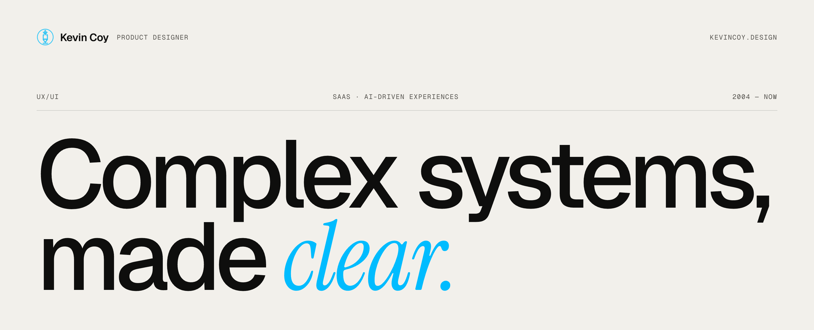
  </picture>
</a>

<p align="center">
  <a href="https://kevincoy.design"></a>
  
  
  
  
  
</p>

<br>

Portfolio of **Kevin Coy**, product designer: 15+ years turning complicated SaaS, enterprise and e-commerce systems into interfaces people understand, from discovery and flows to high-fidelity UI and the front-end code that ships it.

<br>

<a href="https://kevincoy.design">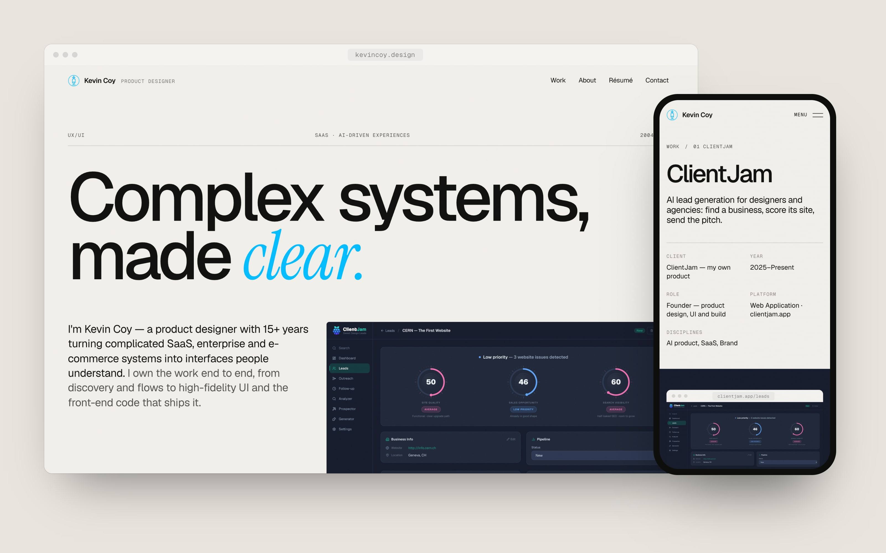</a>

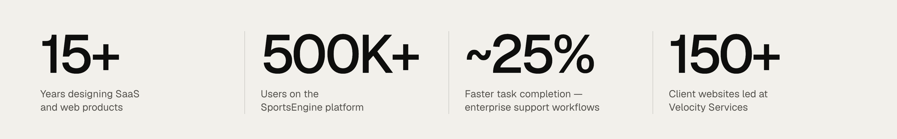

## Selected work

<table>
  <tr>
    <td width="50%"><a href="https://kevincoy.design/work/clientjam">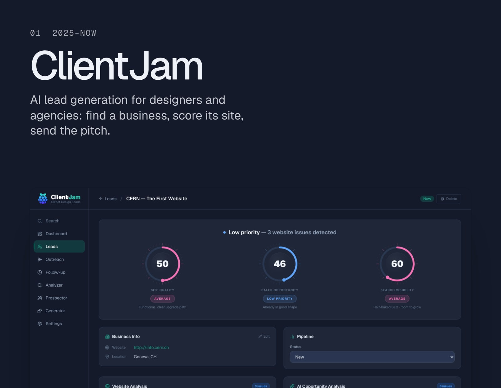</a></td>
    <td width="50%"><a href="https://kevincoy.design/work/helix">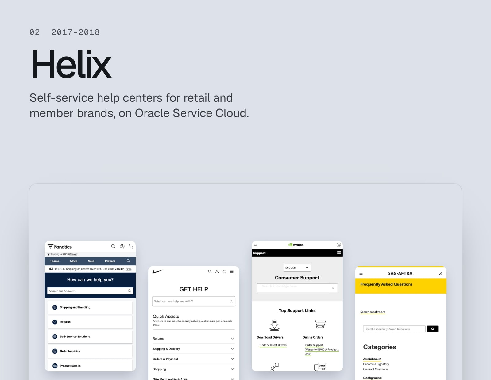</a></td>
  </tr>
  <tr>
    <td><a href="https://kevincoy.design/work/sportngin">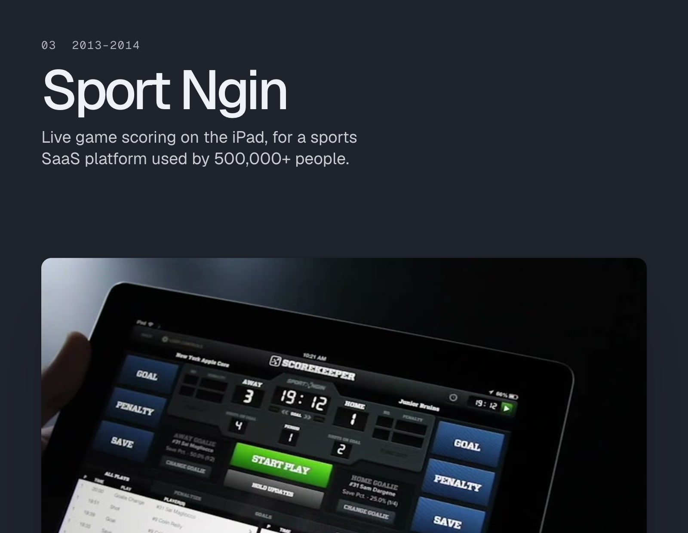</a></td>
    <td><a href="https://kevincoy.design/work/offerbuys">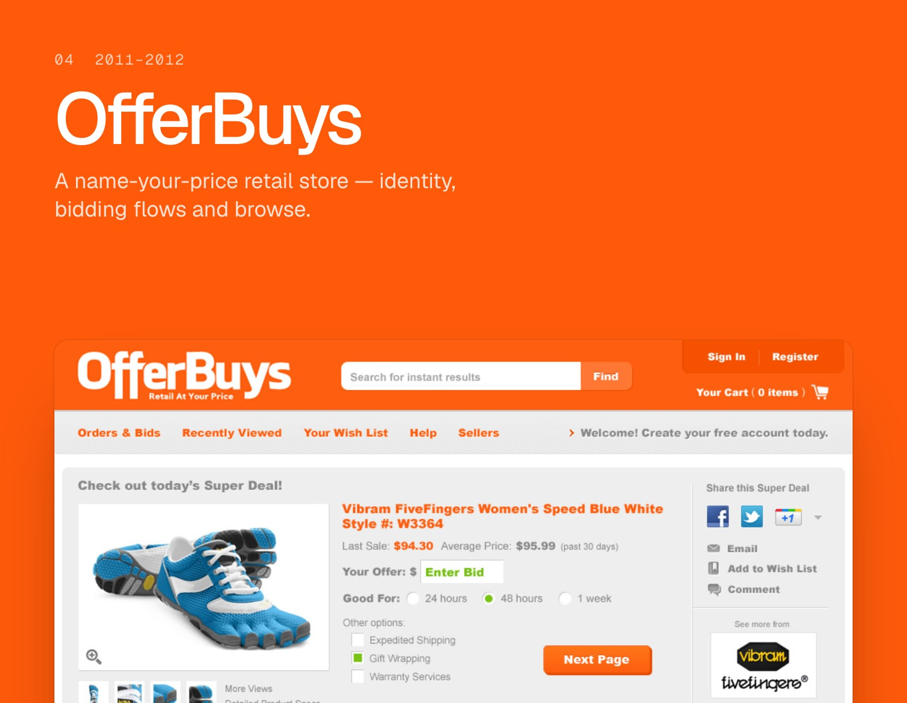</a></td>
  </tr>
  <tr>
    <td><a href="https://kevincoy.design/work/pricegrabber">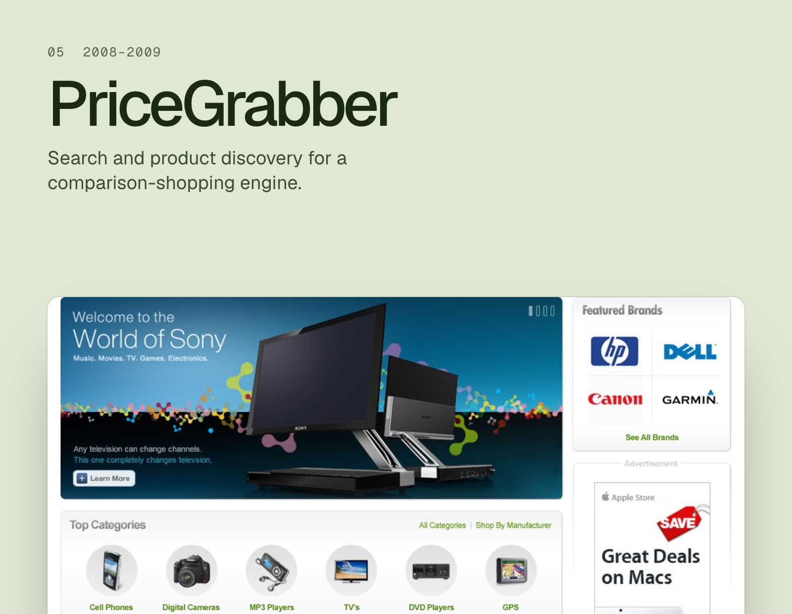</a></td>
    <td><a href="https://kevincoy.design/work/citysearch">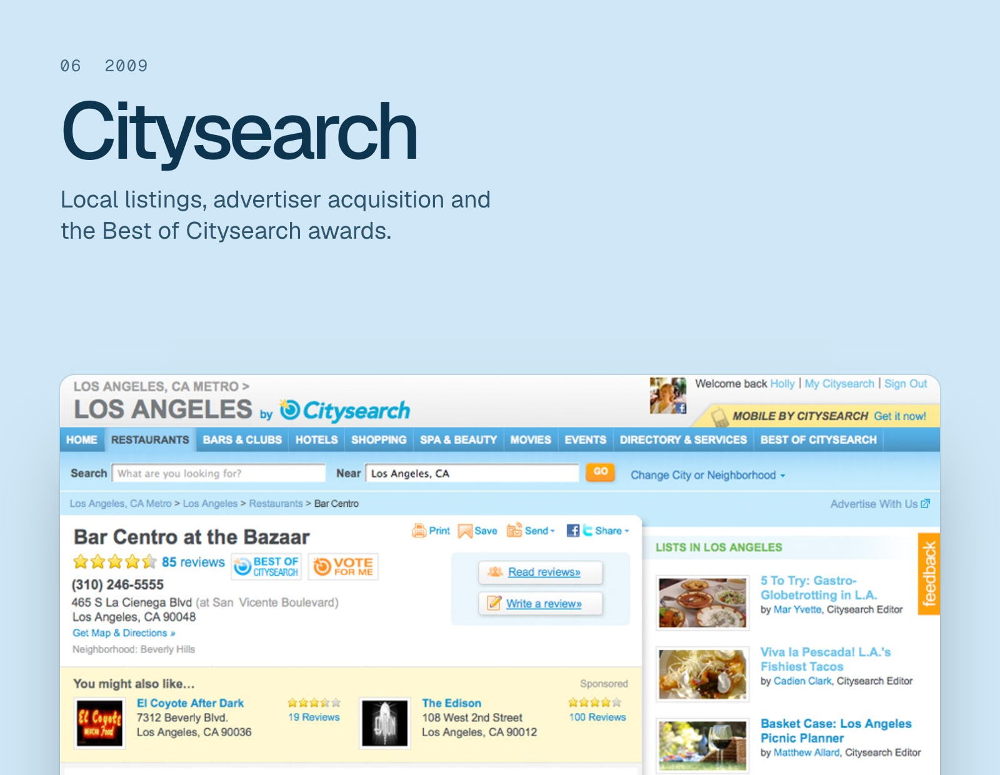</a></td>
  </tr>
  <tr>
    <td><a href="https://kevincoy.design/work/velocity">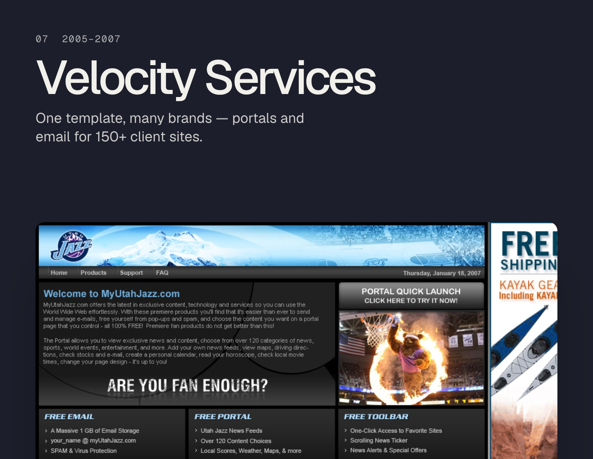</a></td>
    <td valign="middle" align="center">
      <h3>Every case study →</h3>
      <a href="https://kevincoy.design/work">kevincoy.design/work</a>
    </td>
  </tr>
</table>

## Design system

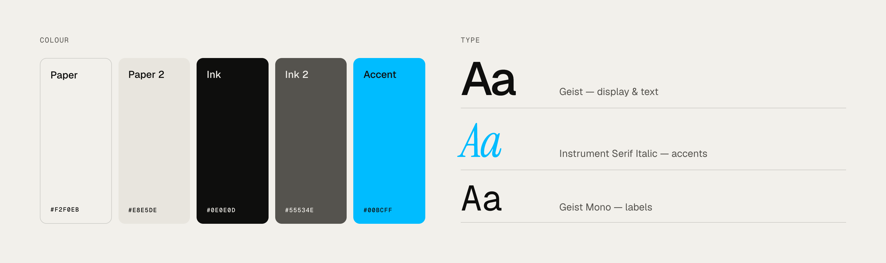

Paper and ink neutrals with one accent; type does the heavy lifting. Tokens live in `src/app/globals.css` (`@theme`).

---

## Develop

Next.js 16 (App Router) · TypeScript · Tailwind CSS v4 · Motion. Fully static export (`out/`); hosted on Cloudflare Pages.

```bash
npm install
npm run dev              # http://localhost:3000 — shows "Asset needed" placeholders
npm run build            # static site in out/
npx wrangler pages dev   # preview the production build
```

### Where things live

| What | File |
| --- | --- |
| Name, contact, summary, experience, skills | `src/content/site.ts` |
| Case studies + recent (text-only) work | `src/content/projects.ts` |
| Project images | `src/assets/work/<slug>/` |
| Project video (mp4 + poster) | `public/work/<slug>/` |
| Résumé PDF (download) | `public/Kevin-Coy-Resume.pdf` |
| Design tokens (color, type, easing) | `src/app/globals.css` (`@theme`) |
| Link preview image | `src/app/opengraph-image.jpg` |
| README graphics | `.github/readme/` (generated by `scripts/readme-graphics.mjs`) |

### Adding a project

1. Put images in `src/assets/work/<slug>/` (≥1920px wide preferred).
2. Import them at the top of `src/content/projects.ts`.
3. Add a `Project` object and append it to `projects`.

The case-study route, work index, homepage showcase, prev/next links and sitemap all update from that array. Case studies are built from flexible blocks: `text`, `image`, `pair`, `gallery` (horizontal), `compare` (before/after slider), `screens` (portrait phone captures; set `device: "phone"` on the media), `video` (mp4 + poster in `public/work/<slug>/`) and `placeholder`. A project can also open with a `film` in place of its cover. Homepage layouts are assigned per slug in `selected-work.tsx`. The site is static, so new content goes live with the next push to `main`.

To promote a "Recent practice" entry to a full case study, add screenshots, add it to `projects` and set `project` on the note.

### Placeholders

`<Placeholder>` slots mark missing assets. They render in development and are **omitted from production builds**, so nothing unfinished ships. Preview them in production with `NEXT_PUBLIC_SHOW_PLACEHOLDERS=true`. See `ASSETS-NEEDED.md`.

### Deploy (Cloudflare Pages)

`next.config.ts` sets `output: "export"`, so `npm run build` writes plain HTML/CSS/JS to `out/`. Pushing to `main` triggers a build of the Cloudflare Pages project `portfolio-kc`; the output directory comes from `wrangler.jsonc`.

- Build command (Pages → portfolio-kc → Settings → Build): `npm run build`
- Site URL defaults to `https://kevincoy.design` (`src/content/site.ts`); override with `NEXT_PUBLIC_SITE_URL` if the domain changes

Images are served as-is (`images.unoptimized`), so export them at the size they're shown (≤2880px wide).

### README graphics

Rendered from the built site with its own fonts and colours. After a visual change:

```bash
npm run build && npx wrangler pages dev --port 8787   # in one terminal
npm run readme:graphics                               # in another (needs Google Chrome)
```

### Motion & accessibility

- Mount animations are CSS (content paints before hydration); scroll reveals use Motion `whileInView`.
- `prefers-reduced-motion` disables transforms, parallax, the hero slideshow, the homepage film loop and the magnetic effect.
- No scroll-jacking: horizontal galleries are native overflow with snap, buttons and keyboard support.
- The before/after slider is a real range input (arrow keys work). Lightboxes are native `<dialog>`.
- The custom cursor label is fine-pointer only and never hides the system cursor.

<br>

<p align="center"><sub>&nbsp; © 2026 Kevin Coy</sub></p>
